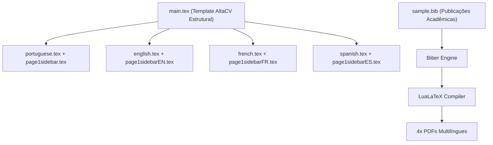

# DESIGN — Curriculum Vitae Architecture & Design Rules

## 1. Arquitetura de Documentos

---

## 2. Princípios de Design

1. **Separação de Idiomas:**
   - O layout base reside em `main.tex` e na classe `altacv.cls`, enquanto o conteúdo específico de cada idioma reside nos respectivos arquivos `.tex`.
2. **Compactação Visual:**
   - O currículo deve manter layout denso e legível de até 2 páginas.
