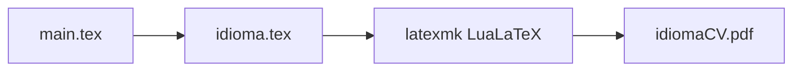

# Curriculum Vitae

[](https://github.com/pedroiff0/cv/actions/workflows/ci.yml) [](LICENSE) [](https://github.com/pedroiff0/cv/stargazers) [](#status-e-próximos-passos)

Currículo em LaTeX com a classe AltaCV, em português, inglês, espanhol e francês. Desde 03/11/2026 os currículos vigentes são editados no ReLaTeX; este repositório guarda o modelo legado e o build em 4 idiomas.

Este projeto faz parte do [portfólio](https://portfolio.phrandrade.com/#cv) de Pedro Rocha.

## Sumário

- [Por que existe](#por-que-existe)
- [Funcionalidades](#funcionalidades)
- [Tecnologias](#tecnologias)
- [Instalação](#instalação)
- [Como usar](#como-usar)
- [Personalização](#personalização)
- [Como funciona](#como-funciona)
- [Trabalhando no projeto](#trabalhando-no-projeto)
- [Status e próximos passos](#status-e-próximos-passos)
- [Contribuindo e suporte](#contribuindo-e-suporte)
- [Estrelas e atividade](#estrelas-e-atividade)
- [Autor](#autor)
- [Licença](#licença)

## Por que existe

Manter o currículo em vários idiomas num editor visual gera versões divergentes. Em LaTeX, um arquivo por idioma compartilha a mesma estrutura e o PDF sai de um comando.

## Funcionalidades

- Layout AltaCV em duas colunas com foto, contato, habilidades e linha do tempo.
- Quatro idiomas: `portuguese.tex`, `english.tex`, `spanish.tex` e `french.tex`.
- Bibliografia com `biblatex` a partir de `sample.bib`.
- Makefile que compila e remove os arquivos auxiliares.

## Tecnologias

  

## Instalação

### Pré-requisitos

- TeX Live com `latexmk` e LuaLaTeX.
- Fontes Font Awesome e Academicons.
- `make`.

### Passos

```bash
git clone https://github.com/pedroiff0/cv.git
cd cv
```

### Conferindo

```bash
make lint
```

Saída esperada: os arquivos TeX de cada idioma são listados como existentes.

## Como usar

### Uso básico

```bash
make all
```

### Exemplos

| Quero | Comando |
| :--- | :--- |
| Compilar o currículo em português | `make portuguese` |
| Compilar em inglês | `make english` |
| Compilar os quatro idiomas | `make all` |
| Limpar arquivos auxiliares | `make clean` |
| Remover também os PDFs | `make distclean` |

## Personalização

| Opção | Onde | Padrão | O que muda |
| :--- | :--- | :--- | :--- |
| Nome e subtítulo | `\name{}` e `\tagline{}` em `<idioma>.tex` | dados do autor | Cabeçalho |
| Foto | `\photo{}{}` em `<idioma>.tex` | `curriculo.jpeg` | Imagem do cabeçalho |
| Contato e links | `\personalinfo{}` | e-mail, GitHub, LinkedIn, ORCID | Bloco lateral |
| Referências | `sample.bib` | exemplo | Publicações citadas |

Não remova as macros `\fa...`: se um ícone não aparecer, troque o motor para LuaLaTeX ou instale as fontes.

## Como funciona

`main.tex` carrega a classe `altacv.cls` e inclui o arquivo do idioma escolhido. O Makefile compila com `latexmk` (`$pdf_mode = 4`, LuaLaTeX) e gera `<idioma>CV.pdf`.



## Trabalhando no projeto

```bash
make lint
make all
```

1. Crie uma branch a partir de `main`: `git checkout -b feat/<assunto-curto>`.
2. Commits no padrão [Conventional Commits](https://www.conventionalcommits.org/pt-br/).
3. Compile os quatro idiomas antes de abrir o pull request.
4. Registre a mudança na seção `Unreleased` de [CHANGELOG.md](CHANGELOG.md).

## Status e próximos passos

Estado atual: **legado**. Os currículos acadêmico e profissional (6 idiomas cada, AltaCV 1.7.4) são editados no ReLaTeX e publicados em [phrandrade.com](https://phrandrade.com); este repositório mantém só o build de 4 idiomas.

- [x] Build em quatro idiomas com AltaCV
- [x] Migração da fonte principal para o ReLaTeX
- [ ] Arquivar o repositório quando o site deixar de referenciá-lo

## Contribuindo e suporte

Issues e pull requests são bem-vindos: veja [CONTRIBUTING.md](CONTRIBUTING.md), [CODE_OF_CONDUCT.md](CODE_OF_CONDUCT.md) e [SUPPORT.md](SUPPORT.md). Vulnerabilidades seguem [SECURITY.md](SECURITY.md).

## Estrelas e atividade

[](https://star-history.com/#pedroiff0/cv&Date)

[](https://github.com/pedroiff0/cv/graphs/commit-activity) [](https://github.com/pedroiff0/cv/commits) [](https://github.com/pedroiff0/cv/issues) [](https://github.com/pedroiff0/cv/pulls)

## Autor

<table>
  <tr>
    <td align="center"><a href="https://github.com/pedroiff0"><br /><sub><b>Pedro Henrique Rocha de Andrade</b></sub></a><br />Autor e mantenedor</td>
  </tr>
</table>

### Contribuidores

[](https://github.com/pedroiff0/cv/graphs/contributors)

## Licença

Creative Commons Attribution 4.0 (CC BY 4.0). Veja [LICENSE](LICENSE). A classe `altacv.cls` mantém a licença do autor original.

Pedro Henrique Rocha de Andrade, 2026.
